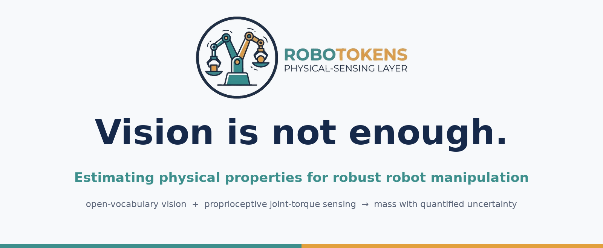
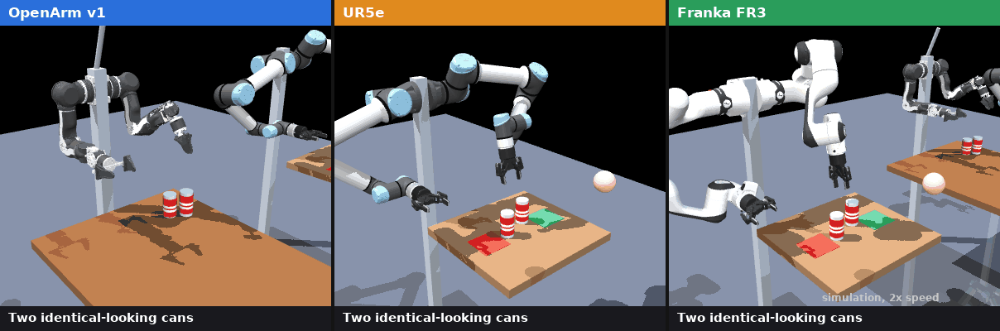
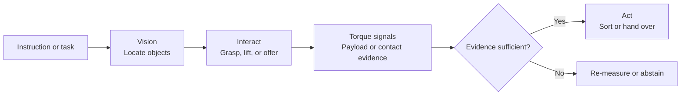

<p align="center">
  
</p>

<h1 align="center">OpenARM FR3 UR5e</h1>

<p align="center"><strong>Contact-aware cross-embodiment manipulation with vision and joint-torque estimation.</strong></p>

<p align="center">
  <a href="#what-it-is">What it is</a> ·
  <a href="#status">Status</a> ·
  <a href="#quickstart">Quickstart</a> ·
  <a href="#contributing">Contributing</a>
</p>

<p align="center">
  
  <br><em>Cross-embodiment simulation: OpenArm, UR5e, and Franka FR3 estimate the relative mass of visually similar objects from their joint torques.</em>
</p>

## What it is

OpenARM FR3 UR5e is an open reference project for **vision-guided manipulation that uses interaction as perception**. A camera can identify and localize an object, but it cannot directly observe whether that object is heavy, empty, compliant, or being held by a person. This project couples open-vocabulary vision with joint-torque signals to estimate payload changes and detect sustained contact.

The repository provides an approachable starting point for cross-embodiment experiments spanning **OpenArm**, **Universal Robots UR5e**, and **Franka FR3** models. Its longer-term target is bimanual, contact-aware behavior: seeing objects, testing physical hypotheses through interaction, and acting only when the evidence is sufficient.

The [OpenARM platform](https://docs.anvil.bot/hardware/openarm) is an open-source bimanual manipulator designed for research and development, with seven degrees of freedom per arm. This repository currently uses its OpenArm v1 model and hardware interface as the initial integration point.



## What you can explore

- **Torque-based payload estimation** — estimate a lifted object's relative mass from joint-torque residuals using model gravity and dithered measurements.
- **Contact-aware handover** — release only after a sustained torque change indicates that a recipient has taken the object.
- **Open-vocabulary object localization** — GroundingDINO and SAM2 locate prompted objects for the physical interaction loop.
- **Reproducible cross-embodiment study** — compare the same estimator over OpenArm v1, UR5e, and Franka FR3 MuJoCo models.
- **Safety-oriented task sequencing** — limit and rate-check motion, latch faults, and abstain rather than make an uncertain mass decision.

## Status

The project is intentionally explicit about evidence levels. Please preserve these distinctions in issues, pull requests, demos, and downstream work.

| Area | Current evidence | Scope |
|---|---|---|
| OpenArm vision, payload estimation, sorting, and contact-based handover | First system tests plus offline tests | **Single left OpenArm hardware integration** |
| OpenArm / UR5e / Franka FR3 payload comparison | MuJoCo study with an assumed, documented error budget | **Simulation only** |
| UR5e or Franka FR3 robot drivers | Not provided | Roadmap |
| Coordinated bimanual control | Not provided; current driver operates the left OpenArm | Roadmap |

The simulation study resolves a 250 g full-versus-empty-can difference on all three modelled arms under its stated assumptions. Its torque noise, friction, offset, and grasp-error values are **assumptions, not hardware measurements**. See [the complete results](docs/cross_embodiment/results.md) before citing or extending them.

## Quickstart

The default test path is offline: it does not need a robot, CAN interface, GPU, or vision weights.

```bash
uv sync --no-default-groups --group dev
uv run --no-default-groups --group dev pytest
uv run --no-default-groups --group dev openarm-fr3-ur5e run --fake --prompt "Sort the two cans: lighter in the left bin"
```

For the full OpenArm and vision setup, use [the setup script](setup.sh) and follow [hardware bring-up](docs/hardware_bringup.md) stage by stage. Any physical-robot operation requires supervision, an accessible e-stop, and review of the hardware documentation first.

## Repository guide

| Looking for | Start here |
|---|---|
| Cross-embodiment simulator and results | [docs/cross_embodiment](docs/cross_embodiment) |
| Payload estimation and contact sensing | [src](src) |
| Vision, calibration, task sequencing, and control | [src](src) |
| Test suite | [tests](tests) |
| Configuration | [configs](configs) |

## Roadmap

Contributions are welcome around:

1. Validated hardware benchmarks and transparent calibration procedures.
2. Reusable embodiment adapters for UR5e and Franka FR3.
3. Coordinated bimanual perception and manipulation with OpenArm.
4. Contact-aware skills beyond payload comparison, including compliant insertion and handover.
5. Better simulation-to-hardware evaluation, documentation, and dataset tooling.

## Contributing

Read [CONTRIBUTING.md](CONTRIBUTING.md) before opening an issue or pull request. In particular, label evidence as simulation, offline test, or physical-hardware observation; do not submit unreviewed motion code for use on a real robot; and keep changes reproducible with the offline test suite where possible.

The project follows the [Code of Conduct](CODE_OF_CONDUCT.md), has a [security policy](SECURITY.md), and is released under the [Apache-2.0 License](LICENSE). If this repository supports your work, please cite it using [CITATION.cff](CITATION.cff).

## Related documentation

- [OpenARM hardware documentation](https://docs.anvil.bot/hardware/openarm)
- [Functional and safety requirements](docs/requirements.md)
- [OpenArm hardware bring-up](docs/hardware_bringup.md)
- [Dashboard](dashboard/README.md)
- [Cross-embodiment results](docs/cross_embodiment/results.md)