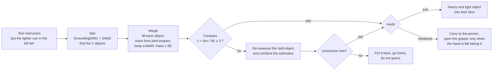
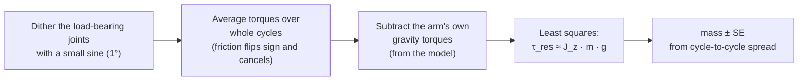
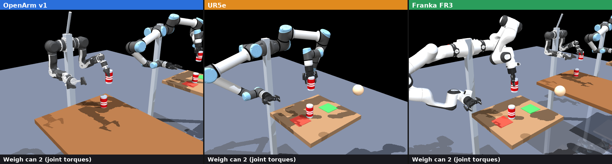
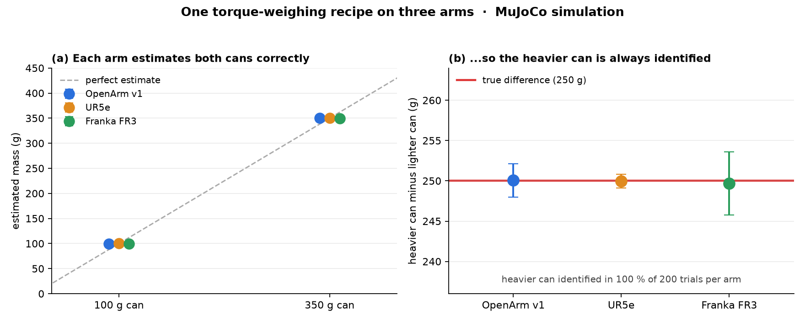

<p align="center">
  
</p>

<p align="center">
  <a href="#the-claim">Claim</a> ·
  <a href="#how-it-works">How it works</a> ·
  <a href="#evidence">Evidence</a> ·
  <a href="#where-it-matters">Business</a> ·
  <a href="#status-and-roadmap">Status</a> ·
  <a href="#navigate-the-project">Navigate</a> ·
  <a href="#getting-started">Get started</a>
</p>

<p align="center">
  
  <br><em>Interactive perception in simulation, 2x speed: three different arms lift two visually identical cans and estimate their mass from joint torques. The masses shown are simulated estimates, not hardware data.</em>
</p>

## The claim

**Problem.** Camera-based perception recovers geometry, appearance and pose. It does not observe **physical properties** such as mass. Objects that are visually indistinguishable but physically different (a full and an empty can) are therefore ambiguous to any vision-only system, and manipulation decisions that depend on mass cannot be made reliably from images.

**Hypothesis.** The arm is itself a sensor. A payload at the tool point produces a predictable change in joint torques, which the actuators already report. Lifting an object and reading the joint torques (*interactive perception*) gives a mass estimate with a quantified uncertainty, with no added hardware.

**Method.**
1. Open-vocabulary vision (GroundingDINO + SAM2) localises the objects named in a free-text instruction.
2. The arm lifts each object and estimates its mass from joint torques (dithered least squares, friction cancelled by averaging over whole cycles). The result is a belief: mass ± standard error.
3. A statistical test on the mass difference (`z = Δm / SE ≥ 3`) decides. If the evidence is insufficient, the robot re-measures, and if it is still insufficient it abstains.
4. The decision drives the task: sorting by weight, or a handover released only when contact is *felt*.

**Evidence.**

| Claim | Support | Level |
|---|---|---|
| Vision, weighing, comparison, sorting and handover run end to end | OpenArm v1 hardware, first system tests, offline test suite | hardware, no benchmarks yet |
| The estimator is not specific to one arm | MuJoCo, OpenArm / UR5e / Franka FR3: 250 g gap recovered, heavier can identified in 200 / 200 trials per arm ([Evidence](#evidence)) | simulation |
| The robot abstains instead of guessing when `z < 3` | implemented and unit-tested ([docs/requirements.md](docs/requirements.md), FR4) | software |

**Not yet shown.** Accuracy and repeatability on hardware across object types, more than two objects, and other arms on real hardware. See [Status and roadmap](#status-and-roadmap).

Business view: [docs/investor_summary.md](docs/investor_summary.md).

## Where vision-only perception fails

| Situation | What vision observes | What the task requires |
|---|---|---|
| Sort full vs. empty cans | two identical cans | which one is heavier |
| Lift something unknown | a shape | how hard to grip and how much effort to use |
| Hand an object to a person | a hand near the object | the moment the person *actually* holds it |
| Ambiguous scene (look-alikes, glare, occlusion) | a guess | a second, independent check |

## How it works



1. **See.** An RGB camera with **GroundingDINO + SAM2** finds the two objects named in the prompt. No retraining is needed per object.
2. **Weigh.** The arm lifts each object in turn, estimates its mass from joint torques, keeps it as a belief (mass ± standard error), and puts the object back.
3. **Decide.** It compares the two masses statistically, measures again if the result is not conclusive, and refuses to guess if it is still unclear.
4. **Act.** It sorts the objects into bins by weight, or hands one to a person and opens the gripper only when it feels them take it.
5. **Show.** A MuJoCo twin follows the real robot. It only reads the robot's state and never commands it.

### The weighing recipe

A mass `m` at the tool point adds `J_z(q) · m · g` to the joint torques, where `J_z` is the vertical row of the tool-point Jacobian. At the weigh pose that is about 1 N·m per 300 g on the shoulder and elbow.



The absolute value is rough (model mass errors, cable drag, current offsets). Both objects are measured the same way at the same pose, so the **difference** is reliable, and the system acts on the difference.

### Safety first

Safety was ported unchanged from the hardware-validated code (SR1 to SR6 in [docs/requirements.md](docs/requirements.md)):
- Every target is clipped to the joint limits and rate-limited inside the 250 Hz servo loop.
- A motor error, lost communication, an unhealthy bus or a large tracking error latches a fault and freezes the arm.
- Every Cartesian line is checked for reachability and collisions before the arm moves.
- On Ctrl+C or any exception, a held object is put back, the arm parks and the motors are disabled.

## Evidence

**Does the principle depend on the OpenArm?** We checked in simulation, without changing any robot code. [docs/cross_embodiment/simulate.py](docs/cross_embodiment/simulate.py) loads three real arm models (OpenArm v1, UR5e, Franka FR3, from [MuJoCo Menagerie](https://github.com/google-deepmind/mujoco_menagerie)). Each holds two look-alike cans, 100 g and 350 g, and weighs them with the recipe from [src/robotokens/sensing/payload.py](src/robotokens/sensing/payload.py). The simulated torques include friction, noise and a 3 % error in the arm model, so the estimator is not graded against itself.

<p align="center">
  
</p>

<p align="center">
  
</p>

| Arm | Est. mass, 100 g can | Est. mass, 350 g can | Difference (true 250 g) | Heavier can identified |
|---|---|---|---|---|
| OpenArm v1 | 100 ± 2 g | 350 ± 1 g | 250 g | 100 % of 200 trials |
| UR5e | 100 ± 1 g | 350 ± 1 g | 250 g | 100 % of 200 trials |
| Franka FR3 | 100 ± 3 g | 350 ± 3 g | 250 g | 100 % of 200 trials |

- **Same recipe, three arms:** the estimator recovers both masses and the 250 g gap on all of them.
- **How the arm's own weight is removed:** these results measure the empty gripper at the weigh pose and subtract it (a tare). The robot code currently subtracts model gravity instead. That variant keeps the difference exact but shifts the absolute masses by the arm-model error, which is why the robot compares objects. The tare is a proposed improvement, and both variants are in [docs/cross_embodiment/results.md](docs/cross_embodiment/results.md).
- **Limits:** it is a simulation, only the OpenArm has run on the real robot, and slow drift between the tare and the load (motor temperature, for example) is not modelled.

## Where it matters

Physical AI has to deal with physics, and properties such as mass or fill level are latent: they are revealed only by interacting with the object ([interactive perception](https://arxiv.org/pdf/1604.03670)). The cases below are documented practices where a weight or contact check already matters. Sources and the honest gaps are in [docs/investor_summary.md](docs/investor_summary.md).

| Case | Documented practice | What RoboTokens adds |
|---|---|---|
| Warehouse and e-commerce picking | Weight checks used as quality control, with added scales ([pick-by-weight](https://logisticsmatters.co.uk/?p=15449), [Rapyuta](https://www.rapyuta-robotics.com/2025/12/12/pa-amrs-with-weight-inspection-in-piece-picking/)) | The check comes from the arm that grasps, with no extra scale |
| Laboratory and pharma handling | Gravimetric tare/gross verification ([BellatRx](https://www.packworld.com/home/article/21203392/pharmaceutical-liquid-filling-monobloc-with-dualweight-verification)) | A screening check inside flexible cells; it does not replace a balance |
| Service and assistive robots | [Assistive robotics](https://www.giiresearch.com/report/vmr2073881-global-assistive-robotics-market-size-share-trends.html) growing with population aging | Handover released on felt contact |
| Robot learning | VLMs infer physical concepts from appearance ([Gao et al.](https://arxiv.org/abs/2309.02561)) | Measured mass labels with uncertainty (research direction) |

## Status and roadmap

| Part | State |
|---|---|
| Vision (detect two objects, camera calibration) | working on the real robot |
| Weighing from joint torques, compare, sort, handover | working on the real robot (first system tests) |
| MuJoCo twin | working |
| Offline test suite (`uv run pytest`) | passes with no robot, GPU or weights |
| Cross-embodiment | simulation of the estimator only |
| Accuracy and repeatability benchmarks | not yet published |

**Next:** validate accuracy across object types, add the tare to the robot code, widen from mass to fill level and stiffness, handle more than two objects, replace the rule-based parser with a language model, and port to other arms.

## Navigate the project

| If you want to... | Go to |
|---|---|
| Understand the business case | [docs/investor_summary.md](docs/investor_summary.md) |
| See what the system must do, with IDs | [docs/requirements.md](docs/requirements.md) |
| Run it on the real robot, stage by stage | [docs/hardware_bringup.md](docs/hardware_bringup.md) |
| Read the weighing code | [src/robotokens/sensing/payload.py](src/robotokens/sensing/payload.py) |
| Read the task state machine | [src/robotokens/task/demo.py](src/robotokens/task/demo.py) |
| See how objects are found | [src/robotokens/vision/](src/robotokens/vision/) |
| Check the safety layer | [src/robotokens/robot/driver.py](src/robotokens/robot/driver.py), [safety.py](src/robotokens/robot/safety.py) |
| Watch runs, camera detections and estimates in a browser (read-only) | [dashboard/](dashboard/) (`dashboard/serve.py`) |
| Reproduce the cross-embodiment study and the animation | [docs/cross_embodiment/](docs/cross_embodiment/) (`simulate.py` for the numbers, `animate.py` for the GIF) |
| Change any setting | [configs/robotokens.yaml](configs/robotokens.yaml) |
| Run the tests | [tests/](tests/) (`uv run pytest`) |

## Getting started

### Setup (one `.venv`, no Docker)

```bash
sudo apt install git cmake g++ libcli11-dev can-utils   # once; libcli11-dev builds openarm_can
curl -LsSf https://astral.sh/uv/install.sh | sh          # once, if uv is missing
./setup.sh                                               # .venv + official OpenArm model + check
```

`setup.sh` does three things:
- Clones `enactic/openarm_mujoco` at the commit validated on the robot.
- Installs everything with `uv sync`: `openarm_can` 1.4.0, torch cu128, GroundingDINO, SAM2.
- Checks that the model weights are present.

On a laptop without the robot, run `./setup.sh --no-hw` instead.

The model weights are not downloaded; they live in `weights/`, which git ignores:

| File | Source |
|---|---|
| `GroundingDINO_SwinT_OGC.py` | github.com/IDEA-Research/GroundingDINO `groundingdino/config/` |
| `groundingdino_swint_ogc.pth` | GroundingDINO release `v0.1.0-alpha` |
| `sam2.1_hiera_small.pt` (or `_large`) | dl.fbaipublicfiles.com/segment_anything_2/092824/ |

### Run it

```bash
uv run pytest                                    # offline: no robot, GPU or weights needed
uv run robotokens run --fake                    # rehearsal, no hardware: default task = hand the heavy can to a person
uv run robotokens run --fake --prompt "Sort the two cans: lighter in the left bin"   # sorting instead

sudo scripts/can_up.sh                           # real robot (see docs/hardware_bringup.md)
uv run robotokens check                          # read-only
uv run robotokens detect                         # where are the objects? (base frame)
uv run robotokens run                            # default task: weigh both, hand the heavy can to a person
uv run robotokens run --prompt "put the lighter can in the left bin"   # sorting instead
```

`run` shows the MuJoCo twin unless you pass `--no-twin`. Object positions come from vision on the real robot and from `task.manual_objects` with `--fake`. Use `--objects manual` or `--xy "x,y;x,y"` to set them yourself.

Each run writes `runs/<time>/report.json` with:
- the parsed intent
- the beliefs (position, mass ± SE, class)
- the comparison
- where each object went
- the phase log

## Reference

### Code layout

```
configs/robotokens.yaml   every setting, one place (strictly validated)
src/robotokens/
  config.py               typed config loader
  robot/                  bus.py (openarm_can | FakeBus), driver.py (250 Hz servo thread, safety, faults),
                          model.py (official MJCF + workcell), ik.py (mink), motion.py (checked moveL,
                          side route), gripper.py (torque-mode grasp), fake.py (payload for --fake)
  sensing/                payload.py (mass from torques, compare), contact.py (felt handover)
  task/                   prompt.py (instruction -> intent), belief.py, skills.py, demo.py (state machine)
  vision/                 camera, calibration (intrinsics + nominal | touch pose), localizer
                          (GroundingDINO + SAM2), top_face, detector, calib_cli
  twin/mirror.py          read-only MuJoCo twin
  cli.py                  `robotokens` command
docs/                     requirements, hardware bring-up, investor summary,
                          cross_embodiment/simulate.py (standalone) and figures/
tests/                    one file per module; IDs from docs/requirements.md
```

### Coordinate frames

Every pose is in the base frame of the official OpenArm v1 model:
- +X points forward, +Y left, +Z up.
- The origin is at `openarm_body_link0`, 0.633 m above the floor.
- The tabletop is at z = 0.092 m. The code derives this from `workcell.table.top_height_m` and `workcell.arm_mount_height_m`.
