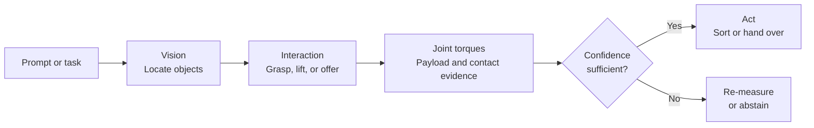

<p align="center">
  
</p>

<p align="center">
  <strong>Vision-guided manipulation with joint-torque estimation and contact-aware control.</strong>
</p>

<p align="center">
  <a href="#quickstart">Quickstart</a> ·
  <a href="#capabilities">Capabilities</a> ·
  <a href="#support-and-evidence">Status</a> ·
  <a href="#packages-and-environments">Packages</a> ·
  <a href="#contributing">Contributing</a>
</p>

<p align="center">
  
  <br><em>Cross-embodiment simulation: the same interaction pattern is evaluated over OpenArm v1, UR5e, and Franka FR3 models.</em>
</p>

## Overview

OpenARM FR3 UR5e is an open research and engineering reference for **contact-aware cross-embodiment manipulation**. It joins open-vocabulary vision with joint-torque signals so a robot can localize an object, interact with it, estimate a payload change, and use sustained contact as task evidence.

The project is built around three complementary questions:

1. **What can the robot see?** Open-vocabulary vision localizes the objects named by a task.
2. **What can the robot infer by interacting?** Model-based torque residuals provide a relative payload estimate with uncertainty.
3. **When should the robot act?** Contact and statistical confidence determine whether to release, re-measure, or abstain.

It is designed as a common starting point for experiments across **OpenArm**, **Universal Robots UR5e**, and **Franka FR3**. The [OpenARM platform](https://docs.anvil.bot/hardware/openarm) is an open-source bimanual manipulator designed for research and development, with seven degrees of freedom per arm. OpenArm v1 is the initial hardware integration in this repository.

> [!WARNING]
> This is research and engineering software, not a ready-to-deploy robot-control product. Review [hardware bring-up](docs/hardware_bringup.md), keep an e-stop accessible, and validate every motion or contact change in simulation before supervised hardware testing.

## Capabilities



| Capability | What it provides | Where to start |
|---|---|---|
| Vision-guided object localization | GroundingDINO + SAM2 workflow for prompted tabletop objects | [Vision modules](src/robotokens/vision) |
| Payload estimation | Relative mass estimate from model gravity and dithered joint-torque measurements | [Payload estimator](src/robotokens/sensing/payload.py) |
| Contact-aware handover | Torque-change latch for a recipient taking an object | [Contact detector](src/robotokens/sensing/contact.py) |
| Safe task sequencing | Confidence-aware sort/handover flow, motion limits, rate limiting, and fault latching | [Task and control](src/robotokens) |
| Cross-embodiment evaluation | Reproducible MuJoCo study over three arm models | [Simulation and results](docs/cross_embodiment) |

## Support and evidence

The repository separates implemented integrations from simulated results and future work. Please preserve these evidence labels in issues, pull requests, and downstream projects.

| Area | Evidence today | Scope |
|---|---|---|
| Vision, torque weighing, sorting, and contact-based handover | First system tests and offline tests | **Single left OpenArm hardware integration** |
| OpenArm / UR5e / Franka FR3 estimator comparison | MuJoCo study with a documented, assumed error budget | **Simulation only** |
| UR5e and Franka FR3 robot drivers | Not included | Planned contribution area |
| Coordinated bimanual operation | Not included; current driver operates the left OpenArm | Planned contribution area |

The cross-embodiment study resolves a 250 g full-versus-empty-can difference on all three modeled arms under its stated assumptions. Torque noise, friction, offsets, and grasp errors in that study are **assumptions, not hardware measurements**. Read [the full methodology and results](docs/cross_embodiment/results.md) before citing or extending it.

## Quickstart

### Offline development and simulation

The default development path needs no robot, CAN interface, GPU, or vision weights.

```bash
git lfs install
git lfs pull
uv sync --no-default-groups --group dev
uv run --no-default-groups --group dev pytest
uv run --no-default-groups --group dev openarm-fr3-ur5e run --fake \
  --prompt "Sort the two cans: lighter in the left bin"
```

### OpenArm and vision environment

For the complete optional environment—OpenArm CAN support, MuJoCo model, GroundingDINO, and SAM2—run:

```bash
./setup.sh
```

On a laptop without the robot, use `./setup.sh --no-hw`. The script reports missing model weights rather than downloading them; see [setup.sh](setup.sh) for the expected files and sources. Before connecting to hardware, complete [hardware bring-up](docs/hardware_bringup.md) in order.

## Packages and environments

The core package targets Python 3.12. Dependency groups keep a minimal development path separate from optional hardware and vision integrations.

| Group | Contents | Use case |
|---|---|---|
| Core | `numpy`, `scipy`, `pyyaml`, `mujoco`, `mink`, `daqp`, OpenCV | Configuration, kinematics, control, and simulation foundations |
| `dev` | `pytest` | Offline unit and integration tests |
| `hardware` | `openarm_can` | Real OpenArm SocketCAN integration |
| `vision` | PyTorch, GroundingDINO, SAM2 | Open-vocabulary detection and segmentation |

The public command is `openarm-fr3-ur5e`. Run `openarm-fr3-ur5e --help` to list bring-up, calibration, detection, weighing, and demo commands.

## Repository map

| Area | Purpose |
|---|---|
| [configs](configs) | Robot, task, workcell, and camera configuration |
| [src/robotokens/robot](src/robotokens/robot) | CAN bus interface, model, kinematics, motion, gripper, and safety |
| [src/robotokens/sensing](src/robotokens/sensing) | Payload and contact estimation |
| [src/robotokens/task](src/robotokens/task) | Task intent, beliefs, skills, and demo state machine |
| [src/robotokens/vision](src/robotokens/vision) | Camera, calibration, detection, and localization |
| [docs/cross_embodiment](docs/cross_embodiment) | Three-arm simulation, animation, methodology, and results |
| [dashboard](dashboard) | Read-only run, camera, and twin monitoring |
| [tests](tests) | Offline tests for the core behavior |

## Roadmap

High-value contributions include:

1. Hardware benchmarks, calibrated uncertainty models, and transparent experimental reports.
2. UR5e and Franka FR3 embodiment adapters with reproducible simulation baselines.
3. Coordinated bimanual OpenArm perception and manipulation.
4. Contact-aware skills beyond payload comparison, such as compliant insertion and handover.
5. Better datasets, evaluation tools, documentation, and simulation-to-hardware workflows.

## Contributing

Contributions are welcome. Start with [CONTRIBUTING.md](CONTRIBUTING.md) and use the issue forms for bugs and research proposals. Every result should identify its evidence tier—**offline test**, **simulation**, or **physical hardware**—and every hardware-impacting change should include a safety note and validation plan.

The project follows a [Code of Conduct](CODE_OF_CONDUCT.md), has a [security policy](SECURITY.md), and is released under the [Apache-2.0 License](LICENSE). If this repository supports your work, cite it using [CITATION.cff](CITATION.cff).

## Further reading

- [OpenARM hardware documentation](https://docs.anvil.bot/hardware/openarm)
- [Functional and safety requirements](docs/requirements.md)
- [OpenArm hardware bring-up](docs/hardware_bringup.md)
- [Cross-embodiment results](docs/cross_embodiment/results.md)
- [Dashboard guide](dashboard/README.md)
