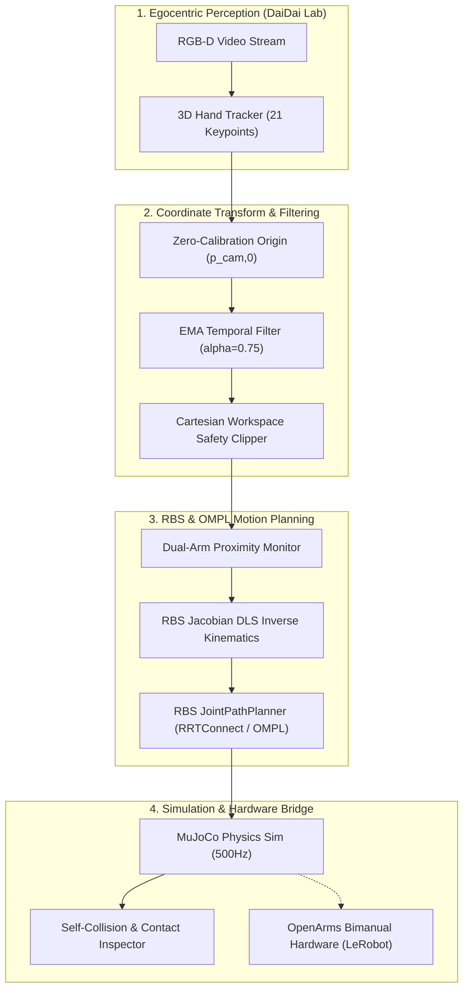

# RoboTokens Architecture Overview

## 1. System High-Level Data Flow

---

## 2. Mathematical Mapping: Human Hands to Robot End-Effectors

The human operator's hand movement in camera coordinates $p_{cam} = [x_{cam}, y_{cam}, z_{cam}]^T$ is converted to the robot world base frame $p_{robot} = [x_{rob}, y_{rob}, z_{rob}]^T$ via:

$$p_{robot} = p_{robot,0} + s \cdot \mathbf{M} \cdot (p_{cam} - p_{cam,0})$$

Where:
- $p_{cam,0}$: The calibrated resting pose of the human operator's hand in camera space.
- $p_{robot,0}$: The nominal home position of the corresponding robot arm end-effector.
- $s$: Scaling factor (default $1.2$) ensuring human desktop reach comfortably covers the robot's physical reach.
- $\mathbf{M}$: Coordinate permutation matrix transforming camera axes ($+X$ right, $+Y$ down, $+Z$ forward) to robot base axes ($+X$ forward, $+Y$ left, $+Z$ up):

$$\mathbf{M} = \begin{bmatrix} 0 & 0 & 1 \\ -1 & 0 & 0 \\ 0 & -1 & 0 \end{bmatrix}$$

---

## 3. RobotBlockSet (RBS) Integration Points

1. **RBS Kinematics:** Computes forward kinematics (FK) and analytical/numerical Jacobians for the 6-DOF OpenArms kinematics chain.
2. **RBS JointPathPlanner:** Solves collision-free motion planning queries using OMPL algorithms (such as `RRTConnect` and `BiTRRT`).
3. **Collision Avoidance:** Evaluates state validity across the 10-DOF bimanual configuration space $q \in \mathbb{R}^{10}$, preventing arm-to-arm self-collisions and arm-to-table collisions.

---

## 4. Safety & Fail-Safe Mechanisms

- **Cartesian Workspace Clipping:** Rigid boundary box $[0.15 \le x \le 0.55, -0.45 \le y \le 0.45, 0.38 \le z \le 0.75]$ meters preventing arm overextension or table strikes.
- **Dual-Arm Proximity Barrier:** Enforces a minimum clearance distance $d_{min} = 8\text{ cm}$ between left and right end-effectors to prevent tool-center collisions.
- **Velocity Clamping:** Limits joint speed to $2.5\text{ rad/s}$ and Cartesian speed to $0.6\text{ m/s}$.
- **Automatic E-Stop:** If contact forces or forbidden link intersections are detected during physics stepping, the controller halts all trajectory execution immediately.
