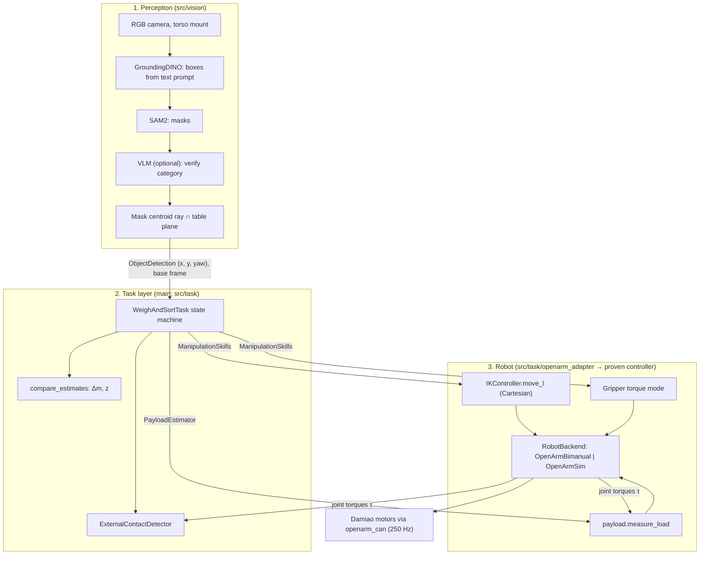

# RoboTokens Architecture Overview

The system answers a question vision cannot: *which of two identical-looking objects is
full?* Perception finds the objects; the arm lifts each one and reads its own joint
torques; the task layer decides and acts. The task spec is in [demo_task.md](demo_task.md).

## 1. Data Flow

The task layer only knows the three Protocols in
[src/task/interfaces.py](../src/task/interfaces.py). The robot side is
[src/task/openarm_adapter.py](../src/task/openarm_adapter.py); vision is mocked from
`VisionObjectDetector` ([src/vision/vision_detector.py](../src/vision/vision_detector.py)); `demo.manual_objects` is the manual fallback.

---

## 2. Object Position From an RGB Camera

There is no depth sensor. Objects rest on a table of known height, so a pixel defines a
ray and the table plane defines where it ends. For intrinsics $K$, camera-to-base
rotation $R_C^R$ and camera center $c$ (from the ChArUco extrinsic calibration):

$$d = R_C^R\, K^{-1} [u,\; v,\; 1]^T, \qquad p = c + \lambda d, \qquad \lambda = \frac{z_{plane} - c_z}{d_z}$$

$(u, v)$ is the SAM2 mask centroid. $z_{plane}$ is the table top, or the plane through
the object's visible center height, consistently. `VisionObjectDetector` uses the top-face centroid at
table + object height and
delivers $(x, y)$ in the robot base frame. The task layer adds the grasp height:
$z_{grasp} = z_{table} + h_{grasp}$.

---

## 3. Mass From Joint Torques ([src/estimation/payload.py](../src/estimation/payload.py))

A payload $m$ held at the TCP adds a joint-torque residual

$$\tau_{meas} - \tau_{model}(q) \approx J_z(q)^T\, m\, g$$

where $J_z$ is the vertical row of the TCP position Jacobian, computed on the official
MuJoCo model. The least-squares mass over the load-bearing joints $\mathcal{J}$ is

$$\hat m = \frac{\sum_{j \in \mathcal{J}} J_{z,j}\, r_j}{g \sum_{j \in \mathcal{J}} J_{z,j}^2}$$

- **Dithering:** the joints move ±1° over whole sine cycles. Coulomb friction changes
  sign with the motion and averages out, which removes the stick-slip ambiguity of a static hold.
- **One $\hat m$ per cycle:** the spread across cycles gives a standard error.
- **Same pose for both objects:** the fixed weigh pose (elbow 90°) cancels most model
  and calibration errors in the *difference*.

---

## 4. Decision

$$\Delta m = \hat m_{heavy} - \hat m_{light}, \qquad z = \frac{\Delta m}{\sqrt{se_1^2 + se_2^2}}$$

- $z \ge 3$: conclusive.
- Below that, both objects are weighed again and each object's two estimates are
  combined by inverse variance ([src/task/weighing.py](../src/task/weighing.py)).
- If it is still below 3, the task stops without sorting.

---

## 5. Felt Handover

At the handover pose the arm holds still and records a holding-torque baseline
$\mu_j, \sigma_j$ over $T_b$. Contact is latched when

$$\exists j:\; |\tau_j - \mu_j| > \max(k\sigma_j,\; \delta_{min}) \quad \text{for } T_{hold}$$

A person who takes the object supports its weight or pulls on it, and both shift the
load-bearing torques. A hand that is merely visible near the object does not. The
gripper opens only on contact; after `timeout_s` the object goes to the heavy bin instead.
Implementation: [src/task/contact.py](../src/task/contact.py).

---

## 6. Simulation and Planning

- `OpenArmSim` ([src/simulation/openarm_sim.py](../src/simulation/openarm_sim.py)) runs the official MuJoCo model behind the same
  `RobotBackend` API, so the whole demo can be dry-run (`run_weigh_demo.py --backend sim --rehearse`).
- The measured workcell scene ([physical_workcell.md](physical_workcell.md)) and the
  OMPL pick-and-place ([run_pick_place_demo.py](../scripts/run_pick_place_demo.py))
  validate reachability and collision-free table approaches in the combined 14-DOF space.
- RBS/OMPL is optional. Real-arm motion uses the official-model mink IK ([src/planning/openarm_ik.py](../src/planning/openarm_ik.py)).
