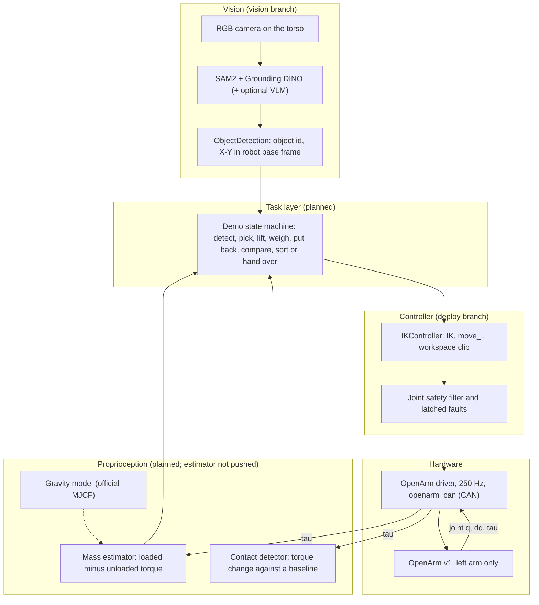

# RoboTokens Architecture

> **Status: final task.** Describes the demo the project is building toward.

The system for the final demo ([demo_task.md](demo_task.md)): vision finds two similar objects, the left OpenArm
grasps and lifts each one, joint torques give each object's mass, and the result decides how the objects are sorted or
handed over. The older egocentric hand-tracking pipeline is deprecated ([legacy register](../legacy/README.md)).

Where each piece lives, and what is built, is tracked in [branches_and_integration.md](branches_and_integration.md).
The contracts between the pieces are in [interfaces.md](interfaces.md).

## 1. Data flow

The loop closes through the robot's own sensing: vision says where, proprioception says what is inside.

## 2. Frames

- **Robot base frame:** $+X$ forward, $+Y$ left, $+Z$ up, origin on the floor under the torso. All commands and all
  object poses use it.
- **Camera frame:** $+X$ right, $+Y$ down, $+Z$ forward (OpenCV convention). The camera is fixed on the torso.
- **Camera to base:** a fixed transform that must be calibrated (hand-eye). It does not exist yet. Vision applies it
  and reports object X-Y in the base frame.
- **Object Z:** not measured; it is the table top height (0.750 m, see [physical_workcell.md](../setup/physical_workcell.md))
  plus the grasp offset.

A pixel $(u, v)$ on the table plane maps to a base-frame point by intersecting the camera ray with the plane
$z = z_{table}$; this is why a known table height is enough to get a 3D grasp point from RGB alone.

## 3. Timing

| Part | Rate |
|---|---|
| Vision detection | as fast as the models run; the task layer only needs a fresh, stable detection before each approach |
| Task state machine | event driven, one decision per state |
| Controller driver (deploy branch) | 250 Hz; Cartesian commands typically 50 Hz |
| Torque window for mass estimation | the arm is held still; averaged over a fixed window |

## 4. Safety

What exists (deploy branch, reported by reading the code, not validated by us):
- Joint position limits with a margin, per-joint velocity limits, and a per-arm Cartesian workspace box.
- Latched faults: a motor error code, a silent motor, CAN bus-off, and a large tracking error. On a fault the
  driver holds the last measured pose and ignores commands until cleared.
- The stop routine moves to the rest pose and then disables the motors. It is **not** a hardware e-stop; keep the
  physical e-stop within reach.

Rules for this project:
- **Only the left arm is enabled.** The right arm has a known hardware problem and is off by default
  (`hardware.right.enabled: false`, see [agents.md](../../agents.md) rule 6). The deploy driver currently enables both arms
  and must gain a per-arm gate before it is run ([branches_and_integration.md](branches_and_integration.md)).
- **Never open the gripper on a timeout** during the hand-over; open only after torque-sensed contact.
- Never send a vision target to the motors without checking it is inside the workspace box and reachable.

## 5. OpenArm sources of truth

- `openarm_can`: low-level motor control (C++ SocketCAN; the Python binding is experimental). Motor IDs, types and CAN
  ports come from its setup scripts.
- `openarm_description`: robot model, joint limits and control gains.
- `openarm_mujoco`: the simulator model (`v1/openarm_bimanual.xml`).
- Official sources are cloned under `third_party/openarm/` and are git-ignored.

Control stays Python-first and does not use ROS. Direct robot I/O is a thin adapter beneath the controller and task
layers.
